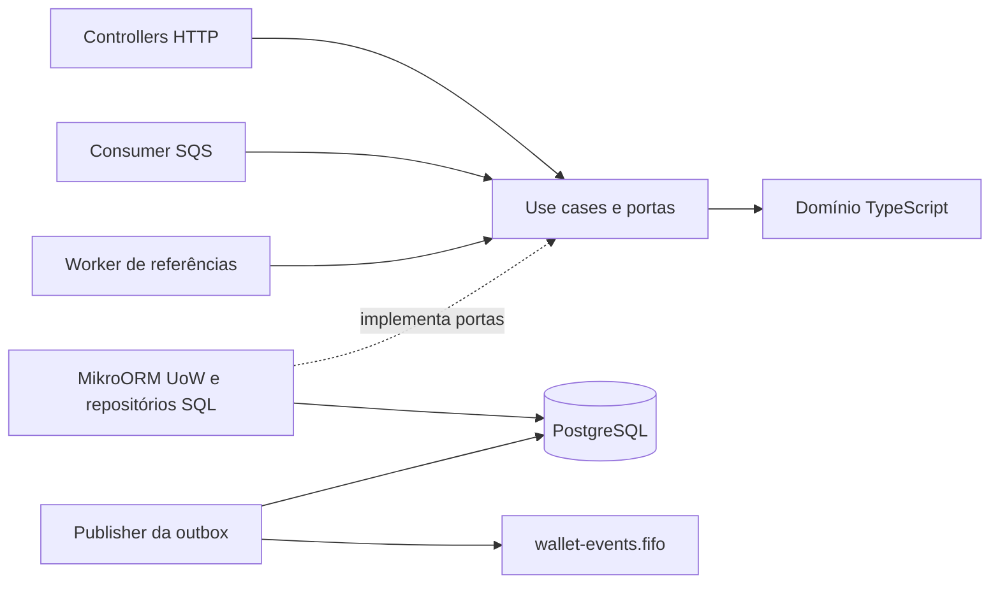

# Arquitetura

O serviço decide operações de aposta e mantém saldo materializado e ledger no
mesmo commit. PostgreSQL é a fonte de verdade para dinheiro, idempotência e
trabalho pendente. SQS transporta comandos e eventos com entrega at-least-once.

Este documento consolida [DECISOES.md](docs/DECISOES.md), a
[matriz de invariantes](docs/INVARIANTES.md) e a [auditoria](docs/AUDITORIA.md).
A especificação é [CHALLENGE.md](docs/CHALLENGE.md). Quando uma escolha posterior
corrige uma proposta inicial, vale a implementação registrada em D19, D22–D24.
Em particular, não há EntitySchema em uso nem garantia de ordem de commit na saída.

## Fronteiras e persistência



`src/domain` contém Money, Wallet, WagerTransaction, LedgerEntry, InboxMessage,
OutboxMessage e eventos. Não importa Nest, ORM nem SDK. Construtores privados e
factories delimitam criação e transições; `rehydrate` reconstrói o estado persistido
sem executar regras de transição novamente.

`src/application` coordena OpenWallet, ProcessWagerTransaction,
ResolvePendingReferences, ReconcileWallet e consultas por portas. Clock,
IdGenerator, FaultInjector e Metrics também são portas. HTTP e SQS chegam ao mesmo
ProcessWagerTransaction e à mesma validação de comando. A resolução reutiliza
`decideWager` e `settleWager`, para não ter outra implementação das regras financeiras.

Nest faz composição e transporte. A infraestrutura fornece PostgreSQL, SQS,
workers, configuração, logs e métricas. O consumer de entrada está em
`src/interface/sqs`; os publishers e laços de background, em
`src/infrastructure/workers`.

MikroORM fornece pool, `em.fork().transactional()` e migrations. A persistência
atual usa registros e mappers com SQL parametrizado no Knex.Transaction do próprio
EntityManager. A configuração tem `entities: []`: a proposta inicial de EntitySchema
(D1) foi substituída por SQL explícito no caminho crítico (D19). Isso deixa visíveis
o FOR UPDATE, os predicados do UPDATE, ON CONFLICT e SKIP LOCKED. O custo é manter
SQL, registros e mappers manualmente, com menos auxílio do mapeamento do ORM.
As entidades de domínio continuam separadas dos registros persistidos.

O migrator recebe uma lista explícita e usa `transactional`/`allOrNothing`.
`disableForeignKeys: false` preserva triggers; desligá-los invalidaria as garantias
financeiras. O teste de migrations compara colunas, índices, constraints, funções
e triggers com o gabarito de referência, além de executar up/down/up sem resíduos.

## Dinheiro e ledger

Money é imutável: centavos em `bigint`, moeda separada e resultado novo a cada
operação. Contratos exigem strings com exatamente duas casas, sem espaços, zeros
iniciais adicionais ou notação científica. Não há arredondamento de entrada.
O teto é `999999999999999999.99`, compatível com `NUMERIC(20,2)`.
O driver devolve NUMERIC como string e o mapper reidrata Money sem passar por float.
Escala fixa permite usar bigint nativo em vez de biblioteca decimal.

BRL atende ao escopo do desafio; o modelo carrega moeda e recusa operações entre
moedas diferentes. Créditos que ultrapassariam o teto são rejeitados com
`BALANCE_LIMIT_EXCEEDED`, antes de mover saldo. Essa decisão vale também para
referências pendentes: uma WIN inválida não pode abortar a BET válida que tornou
sua referência disponível (correção A01/D23).

O ledger registra uma direção, valor positivo, saldo anterior, saldo posterior e
versão da wallet. É um ledger de uma wallet, sem contrapartidas de partidas
dobradas. Não há UPDATE, DELETE ou TRUNCATE permitido nas entradas pelos triggers.
Uma correção financeira exige nova operação, preservando o histórico.

A wallet começa na versão 1. Saldo inicial positivo cria OPENING interna, crédito
v1 e eventos no mesmo commit. Saldo inicial zero não cria transação nem entrada;
a primeira mudança terá versão 2. LOSS e rejeições não alteram saldo ou versão e
não criam ledger. Cada mudança posterior incrementa versão exatamente uma vez.

## Uma decisão financeira, uma transação

Cada tentativa do caso de uso abre uma transação curta em READ COMMITTED:

1. Trava a linha da wallet com `SELECT ... FOR UPDATE`.
2. Se a entrada é SQS, insere inbox com ON CONFLICT DO NOTHING; uma mensagem já
   confirmada vira replay ou conflito de hash.
3. Consulta idempotency key e identidade do provedor. Um replay devolve o resultado
   salvo; conflito não decide nem aplica outra operação.
4. Decide no domínio e insere a transação. Quando há movimento, atualiza a wallet
   condicionando id, versão, saldo anterior e saldo suficiente, e insere o ledger.
5. Insere eventos na outbox e resolve dependências disponíveis da mesma wallet,
   preservando a ordem dos locks. Conclui a inbox no mesmo commit.
6. Confirma. Só depois sai a resposta HTTP ou o DeleteMessage do SQS.

O lock serializa decisões da mesma wallet, inclusive entre processos; wallets
diferentes seguem em paralelo. Não há mutex de processo nem lock global. O UPDATE
condicionado é uma segunda defesa: zero linhas sob o lock é LostUpdateError, erro
de programação, e aborta a transação. CHECKs imediatos recusam saldo negativo;
constraint triggers diferidos validam saldo, cadeia do ledger e versão no commit.
FKs compostas e UNIQUEs asseguram escopo, moeda e unicidade de entradas/reversões.

READ COMMITTED basta porque a decisão ocorre sob o row lock. Otimismo puro
geraria novas tentativas em wallets disputadas; SERIALIZABLE acrescentaria aborts
sem remover a necessidade de coordenar o agregado. O custo escolhido é a espera
na wallet e a duração do trabalho ansioso sob esse lock. Uma cadeia grande de
pendências pode alongar o commit; não há medição de carga que quantifique esse limite.

A ordem é sempre wallet → transações. O worker reivindica pendências em uma
transação separada, termina essa transação e só então trava wallet e relê a
pendência. Nenhum envio HTTP/SQS acontece dentro da transação SQL.

`lock_timeout` limita espera. Lock timeout, deadlock, serialization failure e
perda de conexão são transitórios. Em corrida de UNIQUE da idempotência (23505),
a tentativa inteira faz rollback e relê, no máximo três tentativas. Não se tenta
continuar usando uma transação SQL já abortada.

## Idempotência e respostas

| Identidade persistida | Proteção |
|---|---|
| `idempotency_key` global | Replay com mesmo hash; conflito com hash diferente |
| `(provider_id, external_transaction_id)` | Impede repetir a operação usando outra chave |
| `(consumer_name, message_id)` na inbox | Reconhece redelivery e messageId reutilizado com outro payload |
| `(wallet_id, transaction_id)` e `(wallet_id, wallet_version)` no ledger | Impede dois efeitos da mesma transação e duas entradas na mesma versão |

O hash é SHA-256, hexadecimal, de JSON canônico UTF-8 com chaves ordenadas
recursivamente por code unit UTF-16 e sem espaços. Inclui providerId,
externalTransactionId, playerId, walletId, roundId, gameId, kind,
money `{amount,currency}` e referenceExternalTransactionId quando presente.
Exclui idempotencyKey, headers, messageId, occurredAt e correlationId.
Referência null é normalizada como ausente antes do hash. Não se serializam
instâncias de Money nem valores numéricos nesse subconjunto.

A chave HTTP vem do header obrigatório Idempotency-Key; pela fila, de
data.idempotencyKey. A mesma operação com outra chave é conflito, mesmo que o hash
seja igual. A inbox permite reconhecer a redelivery de uma mensagem confirmada
mesmo se a chave reenviada mudou, comparando o hash de negócio.

O saldo da decisão fica em `result_balance_amount`. Reenviar uma BET após outras
movimentações devolve o saldo daquela BET, inclusive se ela foi rejeitada. Uma
PENDING_REFERENCE ainda não tem saldo final; replay devolve a pendência atual ou
o resultado terminal caso já tenha sido resolvida. O estado terminal não muda.

| Situação | HTTP | Ação do chamador |
|---|---|---|
| Wallet criada | 201 | Usar o id retornado |
| PROCESSED / replay processado | 200 | Aceitar resultado original |
| PENDING_REFERENCE | 202 | Consultar transação |
| REJECTED | 422 | Examinar failureCode; repetição não muda decisão terminal |
| Payload/header inválido | 400 | Corrigir entrada |
| Idempotência ou wallet duplicada | 409 | Resolver conflito |
| Consulta ausente | 404 | Conferir identificador |
| Infraestrutura transitória | 503, Retry-After: 1 | Reenviar com a mesma chave |
| Erro inesperado | 500 | Consultar/repetir com a mesma chave |

O corpo de processamento contém transactionId, status, balance, failureCode e
idempotentReplay. balance é null enquanto pendente. Erros de transporte usam
`{error:{code,message,retryable}}`. WALLET_NOT_FOUND é a exceção: responde 422 com
transactionId e balance null, sem transação persistida porque a FK exige uma wallet.
Na fila, a inbox dessa rejeição é confirmada e a mensagem recebe ack; sua redelivery
continua sendo wallet ausente, mesmo se a wallet apareceu depois (D21).

## Operações e interpretações do enunciado

| Operação | Decisão |
|---|---|
| BET | Débito positivo, sem referência; sem saldo → INSUFFICIENT_FUNDS |
| WIN | Crédito positivo; referência opcional a BET, validada quando informada |
| LOSS | Sem movimento, aceita valor zero ou positivo; referência opcional a BET |
| REFUND | Crédito igual à BET PROCESSED referenciada |
| ROLLBACK | Inverte BET, WIN ou REFUND PROCESSED, pelo valor integral |

As escolhas abaixo tornam explícitos os pontos não fechados pelo enunciado
(D2, D7, D19, D22 e D23):

- A exigência de escala fixa significa que `"1"` e `"1.5"` são inválidos; não são
  normalizados nem arredondados.
- Uma referência só aceita uma reversão processada, somando REFUND e ROLLBACK.
  A leitura literal de §7.4, uma vez por tipo, permitiria dois créditos sobre a
  mesma BET. O índice parcial bloqueia ambos. ROLLBACK de um REFUND é permitido,
  pois referencia o REFUND, não repete a reversão da BET.
- Referência resolve por provider e id externo e exige mesmo player, wallet,
  moeda e rodada. gameId não é parte dessa comparação de escopo (§7.2).
- WIN/LOSS com referência ausente ou ainda não terminal aguardam, assim como
  reversões. Não se credita WIN referenciada antes de confirmar sua BET.
- Referência REJECTED/FAILED causa REFERENCE_NOT_PROCESSED. Reversão sem saldo
  causa REVERSAL_INSUFFICIENT_FUNDS, distinto da falta de saldo em BET.
- OPENING só nasce na abertura interna. Submissão por HTTP/fila é entrada inválida.
- Limite/TTL de pendência rejeita somente se a referência ainda não está disponível
  e terminal. Se já há referência válida, ela é aplicada mesmo após o prazo.

As transições permitidas, espelhadas no domínio e no trigger `fn_tx_guard`, são:

```text
PENDING           → PENDING_REFERENCE | PROCESSED | REJECTED | FAILED
PENDING_REFERENCE → PENDING_REFERENCE | PROCESSED | REJECTED | FAILED
PROCESSED, REJECTED, FAILED → nenhuma transição
```

Reagendar PENDING_REFERENCE conta tentativa; replay não transiciona. FAILED e
PERMANENT_INFRA_ERROR existem no modelo, mas o fluxo atual não terminaliza
incidentes de infraestrutura nesse estado: mensagens permanentes vão à DLQ e
transitórias são tentadas novamente.

Os failureCodes de negócio são INSUFFICIENT_FUNDS, REVERSAL_INSUFFICIENT_FUNDS,
BALANCE_LIMIT_EXCEEDED, CURRENCY_MISMATCH, WALLET_NOT_FOUND, WALLET_PLAYER_MISMATCH,
REFERENCE_NOT_FOUND, REFERENCE_KIND_NOT_REVERSIBLE, REFERENCE_SCOPE_MISMATCH,
REFERENCE_AMOUNT_MISMATCH, REFERENCE_NOT_PROCESSED, REFERENCE_ALREADY_REVERSED e
OPENING_NOT_ALLOWED. Este último é proteção de domínio; na borda, OPENING inválida
é recusada antes de criar uma transação. Códigos são contratos, não mensagens livres.

## SQS, pendências e recuperação

O consumer agrupa o lote por MessageGroupId, processa grupos em paralelo e mantém
sequência dentro do grupo. O grupo recomendado é walletId. Inbox usa o messageId
do envelope e é confirmada junto ao efeito; FIFO não substitui essa proteção.

| Classe de resultado | Tratamento |
|---|---|
| Negócio: processada, rejeitada, pendente ou replay | Commit e DeleteMessage |
| Transitório ou erro inesperado | Rollback quando necessário; visibilidade com backoff de 2 s até 60 s; redrive após 5 recebimentos |
| Permanente: JSON/envelope/payload inválido, conflito de idempotência, hash divergente da inbox | Envio explícito à DLQ com motivo; só depois DeleteMessage |

Falha ao enviar à DLQ mantém a entrada para retry. Crash entre envio e Delete pode
repetir a entrega à DLQ; FIFO ajuda durante sua janela de dedupe, mas não dá
exatamente uma entrega. Long polling usa 20 s, visibilidade 30 s e heartbeat a cada
um terço da visibilidade. SIGTERM interrompe novas buscas e aguarda até 8 s; o
restante volta à visibilidade. Se um commit terminar depois do prazo, a inbox torna
a próxima entrega replay.

Sockets PostgreSQL sem tráfego por 15 s são destruídos. Isso cobre um servidor
pausado que não responde nem fecha conexão: query/rollback não podem esperar para
sempre, e uma conexão com transação incerta não volta ao pool. Há prazos separados
para conectar, adquirir conexão e aguardar lock.

PENDING_REFERENCE já foi aceita e recebe ack: a retomada pertence ao banco. O
worker faz claims SKIP LOCKED e usa next_reference_attempt_at como reserva de 30 s,
pois o schema não tem lease separado para pendências. Antes de decidir, trava wallet
e relê status/token. Claim antigo não consome tentativa nem reaplica terminal.

A primeira tentativa é em 5 s; seguem 10, 20, 40, 80, 160, 300 e 300 s. Na oitava
tentativa sem referência, ou com TTL de 915 s, rejeita com REFERENCE_NOT_FOUND e
evento. O prazo dá minutos para chegada fora de ordem, mas evita espera indefinida
após crashes. Ao terminar uma transação, a resolução ansiosa percorre dependências
da mesma wallet em lotes de leitura de 50, incluindo cascatas, dentro do commit.
Não há limite total artificial da cadeia. O saldo da resposta da referência é
capturado antes dessas movimentações adicionais e permanece seu resultado original.

## Outbox e consumidores de eventos

Eventos WagerTransactionProcessed, WagerTransactionRejected,
WagerTransactionPendingReference e WalletBalanceChanged são envelopes versionados
persistidos no commit financeiro. WalletBalanceChanged só nasce se o saldo mudou.
aggregateId é walletId; dados monetários do evento usam MoneyProps.

Cada instância reivindica até 50 eventos com SKIP LOCKED e lease de 30 s. Fecha a
transação de claim, renova o lease antes do envio e chama SQS com prazo de 10 s.
Marcação de sucesso e renovação verificam id, dono, token de vencimento e lease
vigente. Esse fencing impede um dono atrasado de concluir o claim de outro.

O publisher envia o payload persistido a wallet-events.fifo, grupo = aggregateId,
dedupe = eventId. Só marca published_at depois do envio. Falhas gravam código
sanitizado e backoff de 1 s até 5 min, sem descartar evento por número de tentativas.
Crash antes do envio permite retomada após expirar lease; crash após envio e antes
da marcação pode republicar. A entrega continua at-least-once, inclusive fora da
janela de deduplicação FIFO.

Não há garantia de ordem de commit entre publishers (A03/D23). UPDATE RETURNING
não ordena o lote, e um evento em backoff não bloqueia os posteriores da wallet.
Consumidores devem deduplicar eventId. Projeções de saldo avançam somente com
walletVersion maior; quem precisa da sequência completa deve detectar lacunas e
reconciliar. Não se deve aplicar débitos/créditos novamente com base na chegada
dos eventos.

## Consultas e observabilidade

Ledger usa cursor canônico base64url da wallet_version, comparação exclusiva,
ordem crescente e limit+1 para descobrir continuação. O cursor é opaco por contrato,
mas não é segredo nem credencial. Não há OFFSET. Novos commits podem entrar nas
páginas seguintes; a paginação não mantém snapshot de toda a navegação.

Reconciliação lê saldo materializado, soma assinada do ledger, contagem e diferença
em um único SELECT. O snapshot do statement evita comparar estados de commits
diferentes. `difference = storedBalance - calculatedBalance`; agregados NUMERIC
não sofrem cast para o teto do saldo, permitindo diagnosticar corrupção além dele.
Divergência retorna consistent=false, loga identificadores e incrementa métrica.
Não reescreve saldo, ledger ou outbox.

Pino emite JSON com contexto AsyncLocalStorage de HTTP, SQS e workers. O contexto
leva correlationId, messageId, transactionId, walletId e providerId quando disponíveis.
HTTP devolve X-Correlation-Id. Redação recursiva remove campos financeiros e erros
arbitrários; só códigos seguros de aplicação/domínio/SQLSTATE vão ao diagnóstico.
Erros do driver podem conter o payload mesmo com SQL parametrizado (A02/D23).

Prometheus expõe transições confirmadas por status/kind, replays por canal,
duplicatas de inbox, retries, DLQ explícita por motivo, conflitos de lock, lag da
outbox, latência e divergências. Decisões/inbox só são contadas após commit;
rollback e replay não contam nova decisão. PENDING_REFERENCE e seu terminal contam
como duas transições. Lag consulta a outbox confirmada, inclusive leases/backoff.
Não há labels com IDs. Contadores e histograma são locais ao processo e podem
perder a última observação em crash; não substituem a auditoria persistida.
`sqs_dlq_total` não observa redrive interno do broker.

## Autenticação: extensão existente e desenho proposto

A §2 permite não implementar autenticação. O tempo foi destinado às garantias
financeiras. Hoje AuthGuard nos controllers financeiros delega a
[ProviderIdentityPort](src/application/ports/provider-identity.ts). O adapter
NoopProviderIdentity retorna undefined e permite acesso. Isso não valida bearer
token nem comprova identidade; o serviço local aceita o providerId informado.

O desenho proposto usa IdP externo Keycloak, com client credentials por provedor,
sem cadastro de senhas no serviço. Um adapter da porta validaria assinatura por
JWKS, issuer, audience e validade do access token e devolveria o provider_id
verificado. Ausência/token inválido seria 401; providerId de corpo/rota divergente,
403. A comparação de providerId já existe no guard quando a porta devolve identidade.
Rotação de chaves e falhas na validação devem falhar fechadas.

Só substituir o no-op ainda não resolve autorização: criação/consulta de wallet,
consulta por transactionId, ledger e reconciliação não carregam necessariamente
providerId na rota. Precisariam de política explícita de acesso ao recurso e
escopos, separando provedor de operador. O schema atual também não define vínculo
de propriedade entre provider e wallet; esse contrato exigiria desenho adicional,
não pode ser deduzido de um token válido.

Health permaneceria aberto. `/metrics` hoje também está aberto e poderia ficar
restrito à rede de observabilidade. SQS permanece canal interno confiável conforme
o enunciado, com validação de domínio do providerId; em operação real, permissões
de fila/IAM e isolamento de rede protegeriam esse canal. Nenhum desses componentes
de IdP, autorização ou provisionamento está implementado nesta entrega.

## Evidência, limites e próximos passos

Os testes reais usam PostgreSQL 16 e MiniStack; processos via Bun.spawn comprovam
instâncias separadas. As disputas HTTP usam barreira e observação de backends
esperando lock, além da conferência do banco. Checkpoints before-commit,
after-commit-before-ack, after-claim-before-publish e after-publish-before-mark
matam o processo apenas com NODE_ENV=test e FAULT_POINT armado. Crash anterior ao
commit deve deixar zero efeito; posterior deve permitir replay/retomada.

A auditoria de fase 08 fechou os dois achados ALTA de overflow e vazamento em logs.
Não equivale a aprovação do portão. A fase 09 acrescentou observabilidade e
consultas; docs/PROGRESS.md contém resultados por execução. As pendências são:

- A04: Object.freeze não torna o estado interno de Date imutável. Datas expostas
  ainda podem ser alteradas por setTime; não foi observado caminho de produção que
  faça isso. Copiar instantes nas fronteiras ou usar representação imutável é pendente.
- T01: cenários distribuídos de referência podem passar pela resolução ansiosa.
  Falta prova distribuída específica de aplicação financeira pelo worker agendado.
- T02: donos/PIDs diferentes não provam sobreposição temporal de claims de publishers.
  Testes de componente cobrem SKIP LOCKED/fencing; retirar apenas SKIP LOCKED ainda
  pode deixar uma execução serializada passar.
- T03: pool agregado 75 é menor que as largadas de 252/120 requisições em dois
  cenários. Há prova de participação dos três processos, mas não uma conexão para
  cada requisição simultânea como pede a regra literal do projeto.
- T04–T06: alguns testes antigos não encerram com assertGlobalInvariants; limpeza
  em falha parcial de bootstrap do cluster pode deixar processo; alguns cálculos
  esperados nos testes usam inteiros pequenos em number. Produção monetária usa Money.
- Sabotagens isoladas das garantias novas continuam pendentes onde a matriz assim
  indica. Vermelho natural antes da implementação não substitui `/prove-red`.
- No Windows, Bun pode traduzir SIGTERM diretamente para TerminateProcess, sem
  handler: drain foi testado com falso apenas em unit, não provado por sinal real
  nesse ambiente. Bloqueios de Docker, Bun.spawn e refs/worktree impediram partes
  de portões anteriores; a execução atual deve ser avaliada pela sua própria saída.
- Não há teste de carga, números de throughput/p95, dashboard ou tracing distribuído.
  A imagem MiniStack usa tag latest; não há garantia de reprodução entre versões
  diferentes dessa imagem. O Compose é ambiente local, sem desenho de HA/backup.
- Inbox, transações, ledger e outbox crescem sem política de retenção/arquivamento.
  Não há runbook implementado de reenvio controlado de DLQ; reprocessar exige manter
  identidades e compreender decisões terminais, não apenas reenfileirar payloads.

Com mais tempo, primeiro concluiria o portão e as sabotagens em ambiente com
subprocessos, Docker e worktrees permitidos. Depois fecharia T01–T06 e a exposição
de Date, sem reduzir as asserções existentes. Mediria contenção de wallets,
duração de cadeias ansiosas, capacidade dos pools e lag sob carga antes de mudar
locks ou particionar dados. Em seguida viria autenticação/autorização com IdP,
alertas de lag/DLQ/reconciliação, runbooks de incidentes e retenção que preserve
replay e trilha financeira. Partidas dobradas e ordenação persistente por wallet
seriam mudanças de requisito a avaliar, com migração e novas provas próprias.
